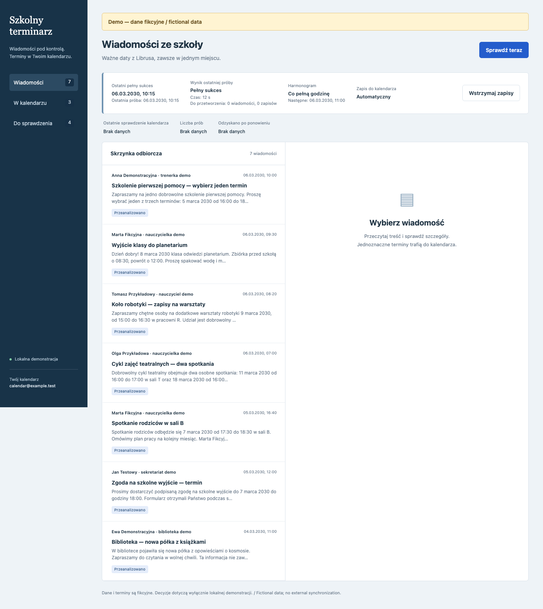
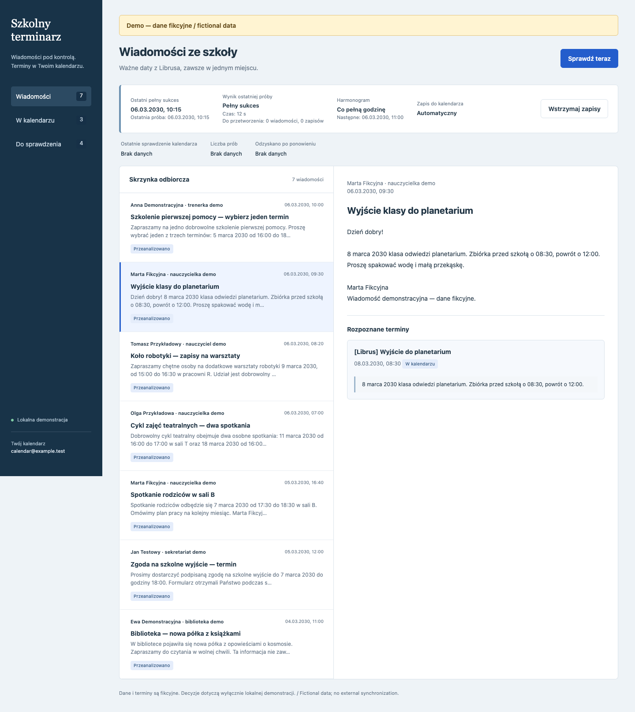
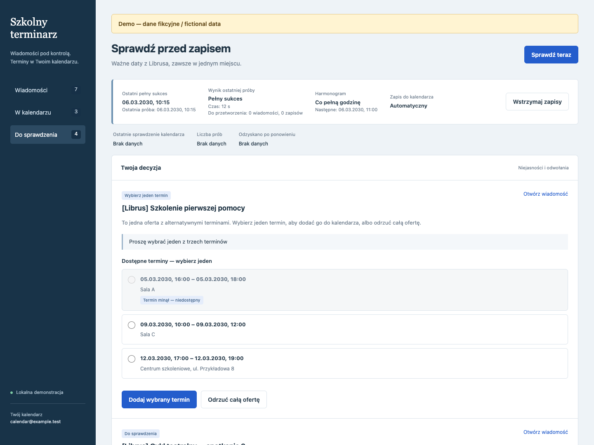
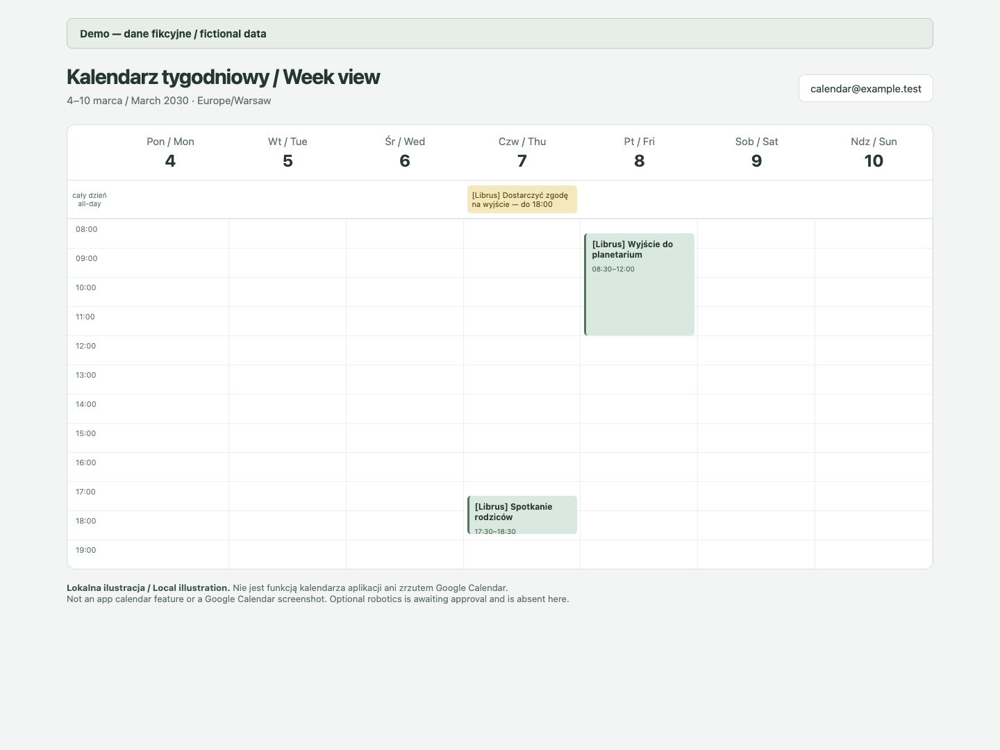

# Librus Calendar

[Polski](README.pl.md) · [Setup](docs/setup.md) · [Demo](docs/demo.md) · [Architecture & safeguards](docs/architecture.md)

A private school inbox that turns messages, announcements and school-calendar entries from **Librus Synergia** into Google Calendar actions, with a review queue for decisions that need a parent.

It reads messages **directly from Librus**. Gmail notifications are not the ingestion source or a trigger. The web interface is currently in Polish.



*Demo — dane fikcyjne / fictional data. All screenshots use newly authored synthetic messages and fake teachers.*

## What it does

- Keeps message bodies, recognized actions, analysis provenance and calendar snapshots in a local SQLite database.
- Groups explicitly alternative dates for one optional offer into one card. Choose one date with no default selection, or reject the whole offer. Past options stay visible and disabled; choosing a date closes the other options. Recurring meetings and separate obligations keep independent decisions.
- Automatically queues clear future school events, reminders and deadlines when calendar writes are enabled. Optional extracurricular activities require participation approval; ambiguity, conflicts and cancellations require review.
- Adds one `[Librus]` title prefix. Descriptions include the source quote, an ownership marker and a **synchronization-start timestamp** in Europe/Warsaw. That timestamp means preparation of the durable operation, not confirmation of a completed calendar write.
- Modifies only app-owned entries on the configured calendar, sends no invitations, and reconciles possible writes before retrying.
- Provides a private Tailscale inbox, an hourly systemd sync and optional Netdata health checks.
- Shows the latest calendar access check and any recovery after its bounded read-only retry; Netdata charts retries and recoveries over the last 24 hours.

## Try it locally

Python **3.12+** is required. The demo needs no Librus credentials, Codex login, connected calendar or account configuration.

```sh
python3 -m venv .venv
.venv/bin/python -m pip install -r requirements.txt
.venv/bin/python scripts/ui_fixture.py
```

Open [http://127.0.0.1:8795](http://127.0.0.1:8795). The real app UI runs against a temporary database, with a fixed clock in March 2030. Approval and sync controls affect only demo state; closing the process removes it. No Librus, AI or external calendar call occurs. See [demo reproduction](docs/demo.md).

## A message, a decision, a calendar entry



*Actual app UI. The recognized result is seeded synthetic data; no model was called.*



*One fictional first-aid offer presents alternative dates; the past option is visible and disabled. No date is selected by default.*



*Local illustration of the same week's entries — **not an app calendar feature or a Google Calendar screenshot**. The unapproved robotics workshop is absent.*

## Use with your own accounts

Real synchronization requires your Librus account, a supported authenticated Codex CLI runtime, an available analysis/tool model, a connected Google Calendar app and write access to the exact configured calendar. These prerequisites are **not bundled**; model names, connector identifiers and supported tools can vary by account and runtime. This is not a standalone OAuth integration. Start with the [configuration and deployment guide](docs/setup.md).

Writes start paused. An initial `sync --dry-run` can still read Librus and invoke AI/calendar read tools; it is not the offline demo. Check the recognized actions and runtime probe before enabling writes.

Analysis and calendar tools default to `gpt-6.1-sol` with `high` reasoning. Only the initial calendar-list probe may retry once after five seconds for a verified unexpected completed tool-call count (zero or multiple). Calendar writes are never retried by this probe policy; uncertain writes require read-only reconciliation. See [probe behavior and diagnostics](docs/setup.md#calendar-probe-and-safe-diagnostics).

## Privacy and limitations

This is an **unofficial**, independently maintained integration, unaffiliated with Librus, Google or OpenAI. It uses undocumented Librus authentication/message interfaces, which can change. It supports messages, announcements, school-calendar entries and informational substitutions, subject to the capabilities available to the authenticated learner. It does not import the full timetable, grades or every school feature. Attachment contents, images, OCR and PDFs are not analyzed or sent to external services.

Message text is private data. Real analysis sends supplied message text and relevant cached event context to the configured AI service; calendar writes send selected event details and source quotes to Google Calendar. Store credentials, database files and backups outside the repository, use restricted file permissions, and keep the interface behind owner-restricted Tailscale access. See [privacy and operating boundaries](docs/architecture.md).

AI can misinterpret dates and context. Automated tests and this offline UI demo do not prove compatibility with your school, your Codex account, your Google Calendar or a live deployment. Inspect early results and retain the operation journal. Automatic database backups are intentionally disabled.

## Development

```sh
.venv/bin/python -m unittest discover -s tests -v
```

The project originated as a personal proof of concept. This public edition contains configurable source code, generic deployment examples and synthetic fixtures; production credentials, messages, state and private deployment evidence are excluded. See [architecture](docs/architecture.md) and the internal [application contract](app/CONTRACT.md).

Licensed under [MIT](LICENSE).

## Multiple Librus sources

New sources default to `multi_source_mode=off`. In `preview`, announcements and school-calendar items are collected and analyzed into a separate read-only queue; they cannot approve proposals, alter human decisions or write Calendar. Activation requires fresh collection and validation. In `active`, verified sources can link to one canonical action instead of duplicating a calendar entry. Semantic matching checks a complete bounded candidate inventory and independently verifies literal evidence. Missing legacy evidence may be separately recovered from an exact hash-bound origin without inventing a historical quote. Older sources with an unknown recipient can only add a labeled corroboration link to a uniquely verified, human-confirmed owned occurrence; they grant no write or future matching authority. Uncertain matches go to review. Replays preserve existing event identities and decisions.

The **Wszystkie źródła** panel filters messages, announcements and school calendar, shows each source's result and reason, and links to the canonical action with all supporting sources and certainty. **Podgląd źródeł** stays separate from decisions. Ordinary school reminders may be labeled optional; extracurricular or unknown participation requires review. Conditional information without a date stays informational. Attachments are labeled **załącznik nieanalizowany**. See [source modes and acceptance](docs/setup.md#multiple-source-rollout).
